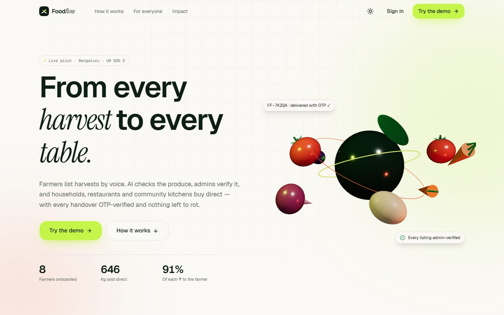
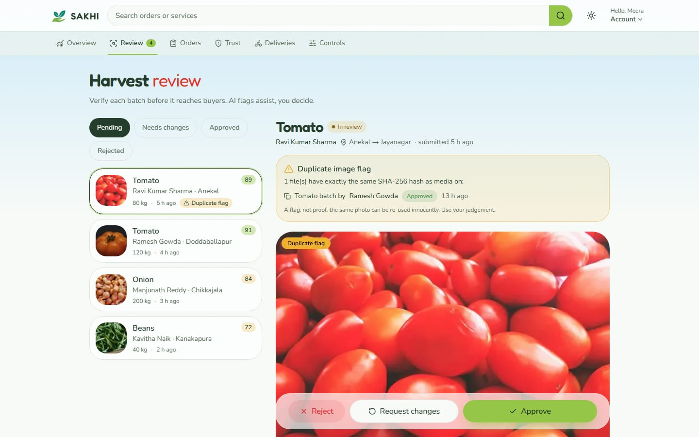
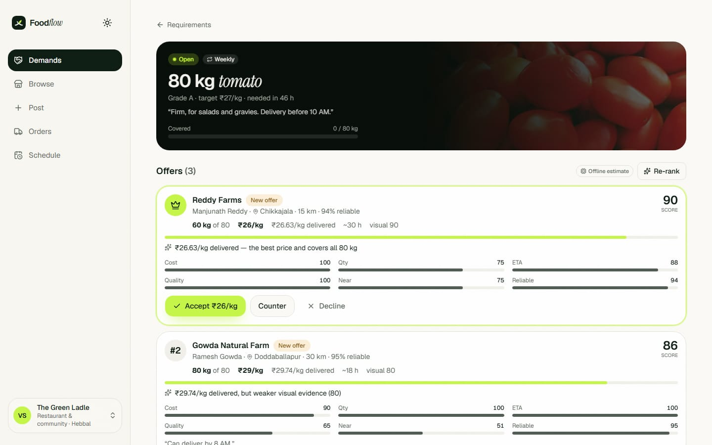
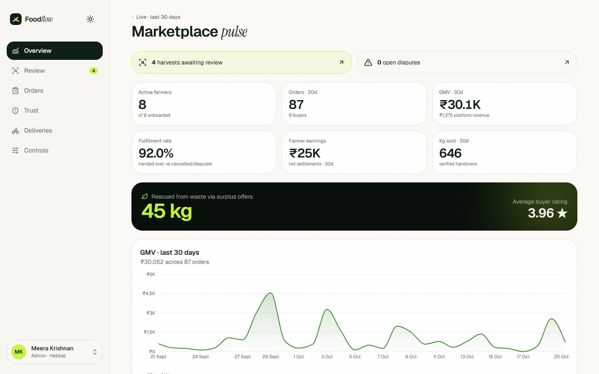
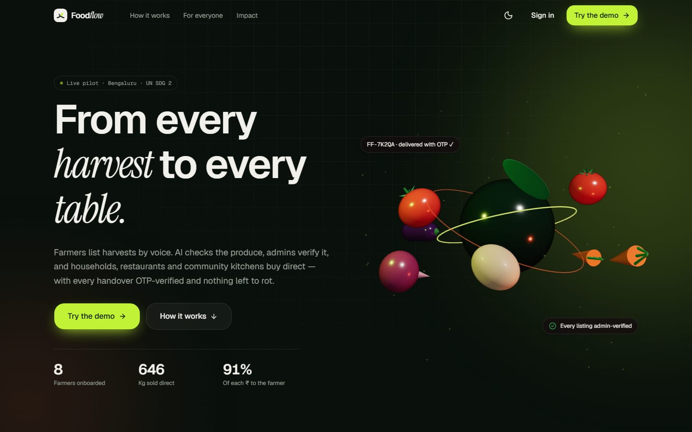
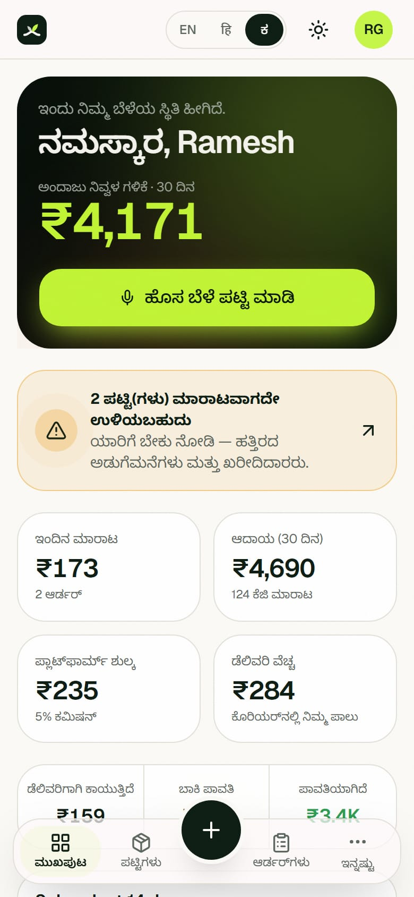
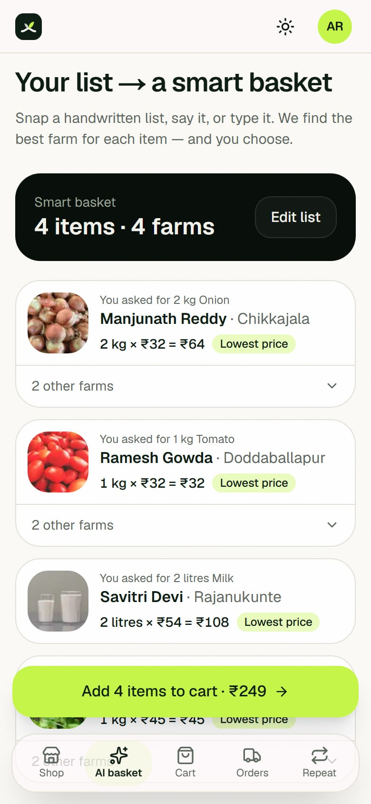
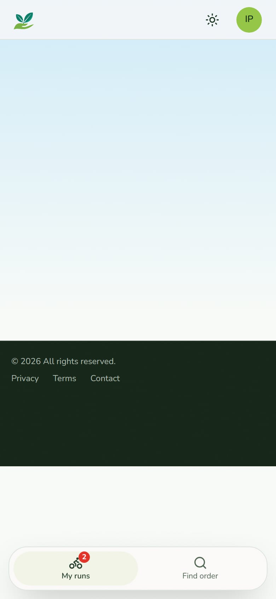
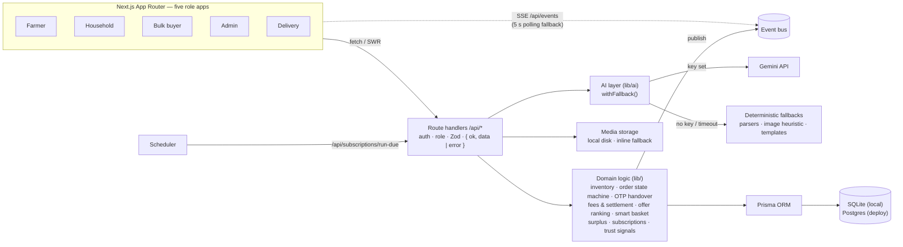
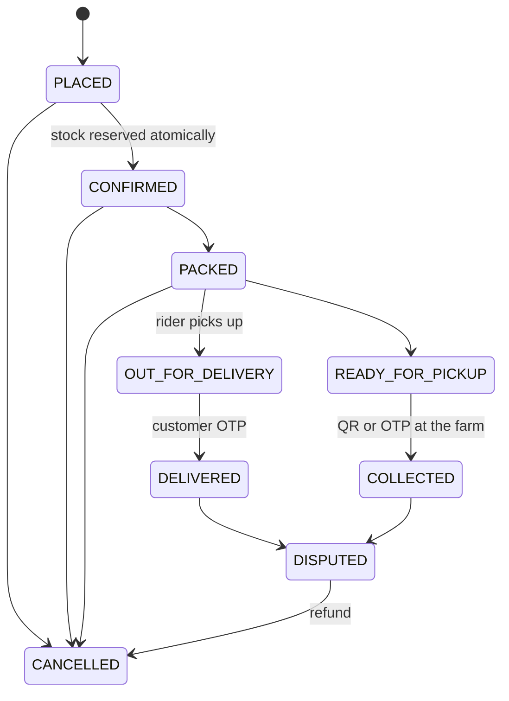

# FoodFlow — From Every Harvest to Every Table

[](https://github.com/skypank-coder/FOODFLOW-From-Every-Harvest-to-Every-Table/actions/workflows/ci.yml)

AI-assisted fresh-produce marketplace connecting smallholder farmers directly with households,
restaurants and community kitchens (UN SDG 2, Zero Hunger).
**A fresh-produce marketplace that connects smallholder farmers directly with households, restaurants
and community kitchens — with AI that assists and people who decide.** Built for UN SDG 2 — Zero Hunger.



---

## The problem

Smallholder farmers sell through long chains of middlemen, so they get a small share of what buyers
pay — and perishable produce that doesn't sell in time is simply lost. Meanwhile households pay retail
markups for produce that is days old, restaurants juggle unreliable suppliers, and community kitchens
that feed people for free struggle to source affordably.

## What FoodFlow does

One marketplace, five apps — each built mobile-first at 360px and scaling up to a full desktop web app.

| Interface | Who | Highlights |
| --- | --- | --- |
| **Farmer** | Smallholders | List a harvest by **voice in Hindi, Kannada or English**; visual quality check on photos/video; indicative price advice from mandi data; orders, bulk offers, surplus rescue, traceable payouts. Whole UI in EN / हिन्दी / ಕನ್ನಡ. |
| **Household** | Consumers | **Snap or type a grocery list → smart basket** across nearby farms; checkout with per-farm delivery; live tracking; OTP doorstep handover; **subscriptions** (milk every morning, vegetables every Sunday). |
| **Restaurant / community kitchen** | Bulk buyers | Post urgent or recurring demand (form, voice or a procurement list); nearby farmers offer from live stock; **offers ranked** on cost, quantity, ETA, quality, distance and reliability; counter-offers; invoices. |
| **Admin** | Operations | Human **verification queue** for every harvest (AI flags, duplicate-photo detection, EXIF capture time); disputes and refunds; trust & safety; platform controls; live analytics. |
| **Delivery** | Riders | Runs, find order by code / QR / voice; a delivery is only complete when the **customer's OTP** is entered. |

### AI assists. People decide.

- **Visual checks, not certificates.** Quality scores describe what's visible in photos — never freshness or food safety.
- **Prices are indicative.** Numbers come from mandi reference prices and comparable listings; the model only rewords the explanation. The farmer sets the price.
- **People approve listings.** AI flags help the admin; a person decides what goes live.
- **OTP or it didn't happen.** Only the customer's one-time code marks an order delivered and releases a payout.
- **Works without a key.** Every AI feature has a deterministic fallback (multilingual parsers, an image heuristic, template text), labelled *Offline estimate* in the UI.

## Screenshots

| | |
| --- | --- |
|  |  |
| Admin review — a re-used photo is flagged; the admin decides | Bulk demand — offers ranked with the reason and every factor |
|  |  |
| Live marketplace analytics | Dark mode |

<p>
  
  
  
</p>

*Farmer dashboard in Kannada · a typed grocery list turned into a smart basket · the rider's run screen.*

## Try it in two minutes

Requires **Node.js 20.9+**.

```bash
git clone https://github.com/skypank-coder/FOODFLOW-From-Every-Harvest-to-Every-Table.git
cd FOODFLOW-From-Every-Harvest-to-Every-Table
npm install
npm run setup   # creates .env, builds the SQLite database, seeds the Bengaluru pilot
npm run dev
```

Open **http://localhost:3000** and press **Get started**: choose **Buyer** (household or restaurant) or
**Seller** and follow the sign-up. The seeded sample accounts below can sign in at `/login` (choose
"I already have an account") with their mobile number and PIN **1234**:

| Role | Phone | Persona |
| --- | --- | --- |
| Farmer | 9000000101 | Ramesh Gowda — Doddaballapur |
| Household | 9000000201 | Ananya Rao — Yelahanka |
| Restaurant | 9000000301 | The Green Ladle — Hebbal |
| Community kitchen | 9000000303 | Annapurna Community Kitchen |
| Admin | 9000000001 | Meera Krishnan |
| Delivery | 9000000401 | Imran Pasha |

**Sign in with Google** needs your own OAuth client: set `GOOGLE_CLIENT_ID` and `GOOGLE_CLIENT_SECRET` in `.env`
and add `<NEXT_PUBLIC_APP_URL>/api/auth/google/callback` as an authorised redirect URI (see `.env.example`).
Members whose account has the same email, or who joined with Google, are signed straight in; new people choose
Buyer or Seller, add a mobile number and finish.

Your location in the top bar follows your device (the browser asks first) and each account can save several
addresses. Messages from the home page's contact form are stored in the `ContactMessage` table.

To start over with fresh sample data at any time: `npm run db:reset`.

### Demo script

1. **Farmer** (Ramesh) → *New harvest* → tap the mic and say *“50 kilo tamatar, aaj tode, 25 rupaye kilo”* (or type it) → check the parsed fields → add photos → see the visual score and price advice → *Send for verification*.
2. **Admin** → *Review* → approve Ramesh's batch; open Ravi's tomato batch, see the duplicate-photo flag, and reject it.
3. **Household** (Ananya) → *AI basket* → type or snap a grocery list → *Build my smart basket* → swap farms if you like → checkout with delivery.
4. **Farmer** → *Orders* → mark packed → *Book delivery*. **Delivery** (Imran) → open the run → *Picked up* → ask the household for the OTP (shown on their order page) → enter it → delivered. The farmer's *Payments* shows the settlement as pending.
5. **Restaurant** (The Green Ladle) → *Post* an urgent 50 kg onion demand → as farmers, make two offers → back as the restaurant, the offers are ranked → accept one.
6. **Farmer** → *Surplus* → a slow-selling spinach lot is flagged → offer it to Annapurna's open demand in one tap.
7. **Admin** → *Overview* shows the new orders and kg rescued; *Trust* and *Controls* show flags, commission, service areas and payouts.

Every step works at a 360px phone width and on desktop.

## Architecture



### Order lifecycle



### How the hard parts work

| Concern | Approach | Where |
| --- | --- | --- |
| **No double-selling** | Stock moves only through a conditional `UPDATE … WHERE availableQty >= qty` inside a transaction; a whole order reserves or nothing does. Cancel releases, handover commits. | `lib/inventory.ts` |
| **Order states** | Explicit transition table; every move is a conditional update on the current status, so racing actions can't skip a step. | `lib/orders/state.ts` |
| **Handover OTP** | Stored as HMAC(secret, delivery, nonce, code); 15-minute expiry; 5 attempts counted atomically; regenerating rotates the nonce and invalidates old pickup QRs. Handover is idempotent and creates exactly one settlement. | `lib/otp.ts`, `lib/delivery/handover.ts` |
| **Who pays what** | Buyer pays subtotal + delivery fee (free retail delivery from ₹499). Commission (default 5%, admin-set) is withheld from the farmer. Courier cost is ₹15 + ₹1.5/km, capped at ₹60; the farmer covers any shortfall over the buyer's fee but never more than 15% of the order. | `lib/fees.ts` |
| **Offer ranking** | Cost as a ratio to the cheapest delivered price, plus quantity, ETA, visual quality, distance and reliability (30/20/15/15/10/10); ×0.6 if it misses the deadline. The model may only explain, not reorder. | `lib/ranking.ts` |
| **Smart basket** | Per item, scores nearby listings on price, ETA, freshness and visual quality, with a bonus for farms that cover several items (fewer deliveries). | `lib/basket.ts` |
| **Surplus rescue** | At risk when sell-through is below the threshold after the minimum age, or the harvest has used most of its shelf life. Rescue offers go to open community-kitchen demand at the buyer's target, never below 70% of the mandi rate. | `lib/surplus.ts` |
| **Subscriptions** | IST slot scheduling; a run claims the plan with a conditional update so overlapping schedulers place one order; falls back to the same farmer, then any farm, when stock runs out. | `lib/subscriptions.ts` |
| **Trust & safety** | SHA-256 duplicate-photo detection across batches, complaint-rate flags, price outliers vs. the mandi reference. Flags only — suspension and pausing are human actions, audit-logged. | `lib/trust.ts` |

## SDG mapping

| Goal | Target | How FoodFlow contributes |
| --- | --- | --- |
| **SDG 2 — Zero Hunger** | 2.1 access to safe, nutritious food · 2.3 smallholder incomes | Surplus produce is routed to community kitchens before it spoils; households buy fresher food direct; farmers keep a larger share. |
| **SDG 1 — No Poverty** | 1.4 equal access to economic resources | Direct market access for smallholders, fair indicative pricing, every fee shown line by line, payouts after every verified handover. |
| **SDG 12 — Responsible Consumption & Production** | 12.3 halve food waste and reduce post-harvest loss | Shelf-life tracking, early surplus detection, one-tap rescue offers, and subscriptions that give farmers predictable demand. The landing page shows kg rescued, live from the database. |

## Tech stack

Next.js 16 (App Router, Turbopack) · React 19 · TypeScript (strict) · Tailwind CSS 4 · shadcn/ui ·
Framer Motion · React Three Fiber · Recharts · Prisma 6 (SQLite locally, Postgres for deploy) · Zod ·
jose (JWT sessions) · SWR · Zustand · sharp · Vitest · Playwright (responsive QA script).

## Scripts

| Command | What it does |
| --- | --- |
| `npm run setup` | First run: creates `.env` with a random secret, applies migrations, seeds demo data |
| `npm run dev` | Development server on http://localhost:3000 |
| `npm run build` / `npm start` | Production build and server |
| `npm test` | Vitest suite — inventory races, OTP rules, fee maths, ranking, subscriptions, parsers |
| `npm run lint` / `npm run typecheck` | ESLint (zero warnings) and TypeScript |
| `npm run db:reset` | Recreate the database and reseed the demo |
| `npm run db:studio` | Browse the data in Prisma Studio |
| `node scripts/screenshots.mjs --role FARMER /farmer` | Screenshot pages at 360 / 768 / 1280 px and flag overflow and console errors |

## Configuration

Copy `.env.example` to `.env` (`npm run setup` does this for you).

| Variable | Required | Purpose |
| --- | --- | --- |
| `DATABASE_URL` | yes | `file:./dev.db` locally; a Postgres URL in production |
| `SESSION_SECRET` | yes | 32+ random characters; signs sessions, pickup QRs and OTP hashes |
| `GEMINI_API_KEY` | no | Enables the Gemini model; without it every AI feature uses its fallback |
| `GEMINI_MODEL`, `AI_TIMEOUT_MS` | no | Model name and per-call timeout before falling back |
| `STORAGE_DRIVER` | no | `local` (default) writes uploads to `public/uploads`; falls back to inline on read-only hosts |
| `CRON_SECRET` | no | Lets a scheduler call `/api/subscriptions/run-due` |
| `DEMO_MODE` | no | One-tap sign-in as seeded accounts (API only). Off in production unless set to `true`; keep it off on a live site |
| `DIRECT_URL` | no | Direct (unpooled) Postgres URL for Neon / Supabase |

## Deploy (Vercel + Postgres)

1. Create a Postgres database (Neon, Supabase or Vercel Postgres).
2. Import the repository in Vercel and set `DATABASE_URL` (and `DIRECT_URL` if your provider pools
   connections), `SESSION_SECRET`, optionally `GEMINI_API_KEY` and `CRON_SECRET`.
3. Deploy. `vercel.json` runs `npm run vercel-build`, which switches the Prisma schema to Postgres,
   pushes the schema and builds.
4. Seed the demo once from your machine:

   ```bash
   export DATABASE_URL="postgresql://…"      # the same URL as on Vercel
   npm run db:postgres && npx prisma db push && npm run db:seed
   git checkout prisma/schema.prisma && unset DATABASE_URL && npx prisma generate   # back to SQLite
   ```

The included cron runs due subscriptions daily at 04:00 IST (the Hobby plan's limit); for
15-minute runs, point any external scheduler at `/api/subscriptions/run-due` with
`Authorization: Bearer $CRON_SECRET`. Live updates fall back to polling on serverless hosts, and
uploaded media is stored inline when the filesystem is read-only.

## Project structure

```
app/                 routes — one folder per role (farmer, shop, bulk, admin, delivery) + /api
components/          UI by role, plus shell, motion, 3D (three/) and landing sections
lib/                 domain logic, AI layer, auth, i18n (en / hi / kn), validators
prisma/              schema, migration and the deterministic demo seed
scripts/             setup, Postgres switch, responsive screenshot QA
tests/               Vitest suites (run against a throwaway SQLite database)
```

## CI/CD

[`.github/workflows/ci.yml`](.github/workflows/ci.yml) runs on every pull request and every push to
`main`:

- **Lint, types & tests** — ESLint, `tsc` (with Next route types), the Vitest suite, a check that
  `prisma/migrations` matches `schema.prisma`, a fresh migrate + seed, and Postgres schema validation.
- **Production build** — `npm run build`, with the Next.js build cache persisted between runs.
- **Deploy** — pushes to `main` that pass both jobs are deployed to Vercel production (built on
  Vercel via `npm run vercel-build`).

To turn on deploys, add these repository secrets (**Settings → Secrets and variables → Actions**):

| Secret | Where to find it |
| --- | --- |
| `VERCEL_TOKEN` | Vercel → Account Settings → Tokens |
| `VERCEL_ORG_ID` | `orgId` in `.vercel/project.json` after running `npx vercel link` |
| `VERCEL_PROJECT_ID` | `projectId` in the same file |

Without them, CI still runs and the deploy job is skipped. The app's runtime variables
(`DATABASE_URL`, `DIRECT_URL`, `SESSION_SECRET`, `CRON_SECRET`, `GEMINI_API_KEY`) stay in the Vercel
project settings. If the Vercel project is also connected to this repo through Vercel's Git
integration, add `"git": { "deploymentEnabled": { "main": false } }` to `vercel.json` so `main`
deploys only after CI passes. Without that, each push deploys twice.

Full documentation (architecture, SDG mapping, screenshots) lands at the end of the build — see
[PROGRESS.md](PROGRESS.md) for what's done so far.
Build notes and decisions: [PROGRESS.md](PROGRESS.md).
